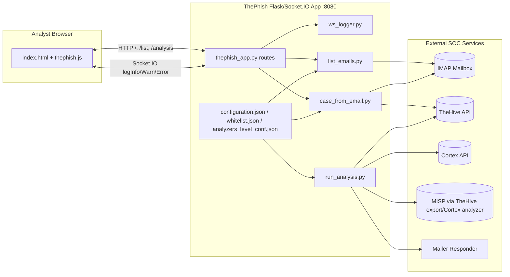

# ThePhish Architecture (Reverse-Engineered)

**Source inspected:** `C:\Users\boser\Downloads\ThePhish-master` (AGPL-3.0, 79 files). Analysis based on actual source files: `app/thephish_app.py`, `app/list_emails.py`, `app/case_from_email.py`, `app/run_analysis.py`, `app/ws_logger.py`, `app/templates/index.html`, `app/static/assets/js/thephish.js`, `app/configuration.json`, `app/whitelist.json`, `app/analyzers_level_conf.json`, `app/logging_conf.json`, `app/requirements.txt`, `docker/docker-compose.yml`, `docker/README.md`, `README.md`, `LICENSE`, `diagrams.md`.

## 1. Repository inventory (summary)

| Path | Type | Purpose / responsibilities | Key deps/integrations | Security implications |
|---|---|---|---|---|
| `app/thephish_app.py` | Python/Flask+Socket.IO | App entry; routes `/`, `/list`, `/analysis`; creates `WebSocketLogger`; orchestrates `list_emails.main()`, `case_from_email.main()`, `run_analysis.main()`; runs on `0.0.0.0:8080` | `flask`, `flask_socketio`, `eventlet.monkey_patch()` | No authn/authz on routes/WebSocket; binds all interfaces; secrets/config loaded by modules |
| `app/list_emails.py` | Python | IMAP connect/login, select folder, search `UNSEEN`, fetch RFC822, require EML MIME part, extract UID/date/from/subject/body/attached EML subject; returns list for UI | `imaplib.IMAP4_SSL`, `email`, `bs4`, `magic` (imported) | IMAP creds in config; processes untrusted email; no explicit timeout/size limits shown |
| `app/case_from_email.py` | Python | Fetch selected UID, parse external From, extract internal EML (rfc822/octet-stream), decode subject, parse headers/body/HTML, extract IOCs via `ioc_finder`, whitelist filtering, extract attachments+SHA256, create TheHive case/template/observables/tasks | `imaplib`, `email`, `ioc_finder`, `emoji`, `thehive4py`, `urllib.parse` | Untrusted MIME/HTML parsing; regex/whitelist logic; uploads artifacts to TheHive; no attachment sandboxing (by design hands off) |
| `app/run_analysis.py` | Python | Start analysis task, enumerate observables/analyzers, special handling (Yara on EML, UnshortenLink_1_2 pre-step + add unshortened URL observable, DomainMailSPFDMARC scoping), run Cortex analyzers via TheHive API, handle `RateLimitExceeded` delayed retries, poll jobs until Success/Failure, parse reports/taxonomies with analyzer-specific tweaks, apply `analyzers_level_conf.json` mapping, compute verdict, mark IOCs, export to MISP (malicious), run Mailer responder, close task/case or leave open if Suspicious | `thehive4py`, `cortex4py`, `time.sleep` polling | Polling loop without global timeout; trusts external reports; responder/case actions are automated; verdict derived from counts only |
| `app/ws_logger.py` | Python | Thin Socket.IO log emitter (`logInfo/logWarning/logError`) to a client `sid` | `flask_socketio` | No auth on SID/channel; log content may include observable values |
| `app/templates/index.html` | HTML/Jinja-served static template | SPA-like UI shell: sidebar links to TheHive/Cortex/MISP, list/analyze controls, log panel, result panel, table | Bootstrap, Socket.IO client, `thephish.js` | External CDNs/fonts; hardcoded service URLs in links; renders server-provided strings into DOM in JS |
| `app/static/assets/js/thephish.js` | JavaScript | Socket.IO connect/log handlers, AJAX `GET /list`, `POST /analysis` with `sid`+`mailUID`, dynamic table/result rendering, auto-scroll logs | Socket.IO, XHR, DOM APIs | Uses `innerHTML` with server/log data in some paths (potential XSS if untrusted data reaches logs/fields) |
| `app/configuration.json` | JSON | IMAP/TheHive/Cortex/MISP/case settings | N/A | Plaintext credentials/API keys |
| `app/whitelist.json` | JSON | `exactMatching`, `domainsInSubdomains`, `domainsInURLs`, `domainsInEmails`, `regexMatching` lists | N/A | Regexes user/config controlled (ReDoS/perf risk if modified unsafely) |
| `app/analyzers_level_conf.json` | JSON | Per-analyzer `dataType` and `levelMapping` overrides | N/A | Misconfiguration changes verdicts |
| `app/logging_conf.json` | JSON | stdlib logging dict config (console handlers, DEBUG for modules) | `logging.config` | Logs may expose sensitive observables |
| `app/requirements.txt` | pip deps | Pinned deps (Flask/SocketIO/eventlet/TheHive4py/Cortex4py/ioc-finder/etc., old versions) | PyPI | Old/vulnerable dependency risk; supply-chain surface |
| `docker/docker-compose.yml` | Docker Compose | Cassandra, TheHive, Elasticsearch, Cortex, Redis, MySQL, MISP, ThePhish stack; mounts conf files; exposes ports | Docker images | Exposed services/ports; `/var/run/docker.sock` mounted to Cortex; default/example creds in ecosystem |
| `docker/thehive/application.conf` | HOCON-like conf | TheHive connector config for Cortex/MISP (in docker context) | TheHive | API keys/secrets placeholders; TLS `acceptAnyCertificate` patterns possible in examples |
| `docker/cortex/application.conf` | conf | Cortex config | Cortex | Service config/secrets |
| `docker/README.md` | docs | Setup/operation guidance | N/A | Operational guidance; contains credential/config steps |
| `README.md`, `diagrams.md`, `LICENSE`, `.github/*`, `CONTRIBUTING.md`, `CODE_OF_CONDUCT.md` | docs/meta | Usage, architecture narrative, diagrams refs, AGPL-3.0 license, contribution templates | N/A | AGPL obligations for modification/network use/distribution |

> Note: `app/__init__.py` is empty. `app/static/assets` contains bundled Bootstrap/font/image/theme assets used by UI.

## 2. High-level architecture

## 3. Component responsibilities

- **Web/API layer (`thephish_app.py`)**: synchronous request handlers; no background worker abstraction. `/analysis` blocks until case creation + analysis complete (long HTTP request) while streaming progress via Socket.IO.
- **Email ingestion/listing (`list_emails.py`)**: mailbox polling on demand (not continuous daemon), filters unread emails that contain an EML-like attachment and extracts display metadata.
- **Parsing & case building (`case_from_email.py`)**: transforms forwarded email-with-EML into TheHive case + observables; performs IOC extraction and whitelist suppression before observable creation.
- **Analysis orchestration (`run_analysis.py`)**: drives Cortex jobs through TheHive/Cortex APIs, normalizes analyzer verdicts, aggregates to email verdict, performs case/task lifecycle actions and optional MISP export/notification.
- **Realtime logging (`ws_logger.py`, `thephish.js`)**: best-effort progress channel keyed by client `sid`.
- **Configuration/rules**: JSON files control connectivity, case defaults, whitelist behavior, and analyzer severity mapping.

## 4. Key architectural characteristics

- **Service-coupled design:** core workflow depends on IMAP + TheHive + Cortex (+ optional MISP/Mailer responder behavior) rather than local standalone analysis.
- **Module-global state:** `case_from_email.py` and `run_analysis.py` use module-level globals (`config`, `log`, API clients, whitelists), loaded per `main()` call.
- **Synchronous/polling orchestration:** analyzer completion via repeated `time.sleep` + job status polling; rate-limited analyzers retried in a loop.
- **Heuristic verdict aggregation:** final verdict is count-based over per-observable normalized analyzer levels (`malicious`/`suspicious`/`info/safe/error-implicit`).
- **Evidence/case externalization:** primary evidence objects, tasks, and observable records live in TheHive, not in an internal PhishGuard-native store.

## 5. Limitations observed (evidence-based)

- No endpoint/session authentication or CSRF protection in app routes.
- Plaintext secrets in config files; logging can include sensitive values/observables.
- Verdict ignores analyzer confidence/weights and treats absence/failed jobs as non-malicious by aggregation behavior (failed jobs recorded with empty result; no explicit "unknown" escalation in final count).
- Polling loops lack explicit max timeout/cancellation budget; `delayed_jobs.remove` while iterating can skip elements.
- Regex/whitelist matching and IOC extraction run on untrusted content without explicit resource bounds.
- Frontend inserts log/field strings via `innerHTML` in places, risking injection if upstream data is attacker-controlled.
- Tight coupling to specific TheHive4py/Cortex4py APIs and legacy service versions (per pinned requirements/docker images). 
