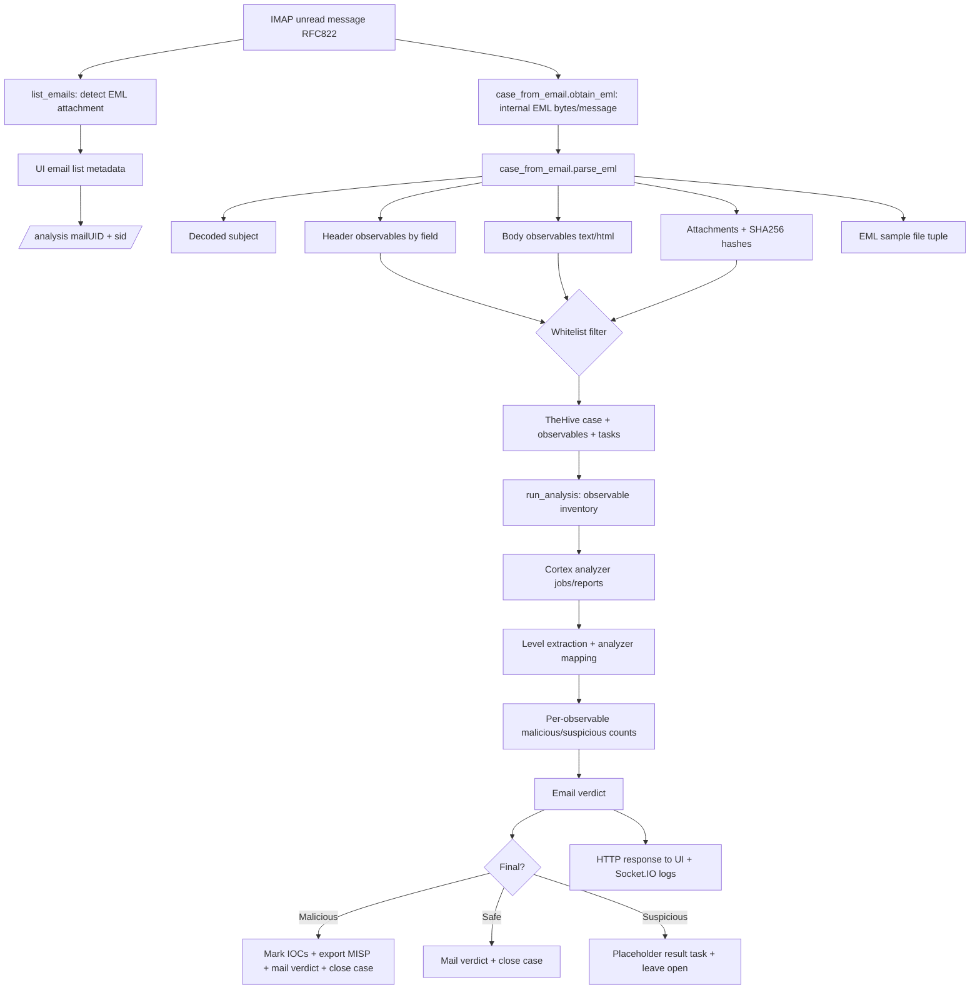

# ThePhish Data Flow (Reverse-Engineered)

This document traces primary data objects and transformations in the inspected source (`app/list_emails.py`, `app/case_from_email.py`, `app/run_analysis.py`, `app/thephish_app.py`, configs).

## 1. Data flow overview

## 2. Ingestion data (`list_emails.py`)

| Stage | Input | Processing | Output | Notes |
|---|---|---|---|---|
| IMAP connect | `configuration.json` imap host/port/user/password/folder | `IMAP4_SSL` login, `select(folder)` | live connection | credentials from config |
| Unread search | selected mailbox | `search(None,'(UNSEEN)')` → UID list | candidate UIDs | only unseen messages |
| Message fetch | UID | `fetch(uid,'(RFC822)')`, parse with `email.message_from_bytes` | external message object | flags may change on fetch in normal IMAP behavior |
| EML detection | MIME walk | check part type/filename/headers for `message/rfc822` or `application/octet-stream` `.eml` | internal EML payload/message and attached-mail subject | only messages with detected EML are listed |
| UI shaping | parsed fields | decode `From/Subject`, body from `text/plain` or stripped HTML | `{mailUID,date,from,subject,body,attachedMail}` | body included for preview in UI table |

## 3. Case-creation data (`case_from_email.py`)

### 3.1 Selected message retrieval (`obtain_eml`)
- **Input:** IMAP connection, `mail_uid`.
- **Validation:** UID must still be in current `UNSEEN` search results; otherwise emits error (handles concurrent analyst selection).
- **Extraction:** external sender (`From`) decoded/parsed for notification target; internal forwarded EML extracted from MIME part.
- **Output:** `(internal_msg: email.message.Message, external_from_field: str)`.

### 3.2 Parsing and observable extraction (`parse_eml`)
- **Subject:** decoded from possibly split/encoded header parts; returned as case/EML filename basis.
- **Header IOC scan scope:** `To, From, Sender, Cc, Delivered-To, Return-Path, Reply-To, Bounces-to, Received, X-Received, X-OriginatorOrg, X-Sender-IP, X-Originating-IP, X-SenderIP, X-Originating-Email`.
- **Body IOC scan scope:** decoded `text/plain` parts and `text/html` parts after `urllib.parse.unquote` + `&amp;` replacement.
- **IOC extraction (`search_observables`)** via `ioc_finder`:
  - `parse_urls(no_scheme=True)` → type `url`
  - `parse_ipv4_addresses` → `ip`
  - `parse_domain_names` (and domains parsed from found URLs) → `domain`
  - `parse_email_addresses` → `mail`
  - per-value whitelist check (`is_whitelisted` exact/regex/domain-in-* rules); whitelisted values skipped and logged.
- **Attachments:** for non-attachment parts containing IOCs from body: scanned; for attachment disposition parts: filename/mimetype whitelist check, keep in-memory bytes tuple, compute SHA256 hash observable unless hash whitelisted.
- **EML evidence observable:** generated from parsed internal message (`BytesGenerator.flatten`) as `<subject>.eml`.
- **Post-processing:** URL values split on `<`/`>` workaround to reduce HTML-tag contamination.
- **Output:** subject, `observables_header{field->[observables]}`, `observables_body[]`, `attachments[]`, `hashes_attachments[]`, `eml_file_tuple`.

### 3.3 TheHive object creation (`create_case`)
- **Template:** ensures `CaseTemplate` named `ThePhish` with tasks `ThePhish notification`, `ThePhish analysis`, `ThePhish result`.
- **Case:** title from emoji-stripped subject (template prefix `[ThePhish] `), `tlp/pap/tags` from config, description `Case created automatically by ThePhish`.
- **Observable mapping:**

| Source | TheHive dataType | Tags | Message/context | IOC initial |
|---|---|---|---|---|
| Header IOC | `url/ip/domain/mail` | `email`, `email_header`, `email_header_<Field>` | found in header field | false |
| Body IOC | `url/ip/domain/mail` | `email`, `email_body` | found in email body | false |
| Attachment file | `file` | `email`, `email_attachment` | attachment | false |
| Attachment hash | `hash` | `email`, `email_attachment_hash` | hash of attachment name | false |
| Internal EML sample | `file` | `email`, `email_sample` | attached email in eml format | false |

- **Result:** created case response (used as case handle downstream).

## 4. Analysis and verdict data (`run_analysis.py`)

### 4.1 Inputs/config
- `configuration.json`: TheHive/Cortex/MISP endpoints/keys/ids.
- `analyzers_level_conf.json`: per-analyzer `dataType` scope and `levelMapping` (`malicious/suspicious/safe/info`).
- `whitelist.json`: URL exact/regex and `domainsInURLs` used when accepting unshortened URLs.

### 4.2 Observable and job data structures
- **`observables_info[]`:** `{name,type,tags,id}`; EML attachment represented as `file_message/rfc822` for dispatch logic.
- **`jobs[]`:** `{job_id, observable_id, status}` (`NotTerminated` → `Success|Failure`).
- **`delayed_jobs[]`:** `{analyzer_name, observable_name, observable_type, observable_id}` for `RateLimitExceeded` retries.
- **`reports_observables[]`:** `{observable_name, observable_type, observable_id, analyzer_name, analyzer_result}` where `analyzer_result` is normalized level or empty on failure.

### 4.3 Analyzer dispatch transformations
- Discover analyzers by type from Cortex (`file,url,domain,ip,mail,hash`).
- **EML:** only `Yara_2_0`.
- **URL pre-step:** `UnshortenLink_1_2` run first and polled; if expanded URL found and not whitelisted, create new TheHive URL observable tagged `unshortened_url` and append to processing lists.
- **Domain SPF/DMARC scoping:** `DomainMailSPFDMARC_Analyzer_1_1` only for `domain` observables whose tags indicate specific header origins (`From/Sender/Return-Path/Reply-To/Bounces-to/Received/X-Received/X-OriginatorOrg/X-Originating-Email`).
- **Rate limit handling:** queue and retry start attempts every 10s until started.

### 4.4 Report normalization
- Default extracted level: `info` if missing/empty taxonomy path.
- Analyzer-specific extraction overrides:
  - `Pulsedive_GetIndicator_1_0`: last taxonomy level.
  - `IPVoid_1_0`: last taxonomy level.
  - `Shodan_Host_1_0`, `Shodan_Host_History_1_0`: last taxonomy level.
  - `SpamhausDBL_1_0`: malicious if first taxonomy value in specific 127.0.1.x codes.
  - `URLhaus_2_0`: malicious if full report indicates threat/query ok despite info taxonomy.
- Apply `analyzers_level_conf.json` mapping when analyzer configured for observable data type.
- Failed jobs: logged as warnings, `analyzer_result` remains empty string.

### 4.5 Verdict aggregation and case updates
- Per observable: count reports with `analyzer_result == 'malicious'` and `'suspicious'`.
- If malicious count > 0: observable marked `ioc=True`, increments malicious observable counter.
- If suspicious count > 0: increments suspicious observable counter.
- **Final verdict:**
  - any malicious observable → `Malicious`
  - else any suspicious observable → `Suspicious`
  - else → `Safe`
- **Side effects by verdict:**
  - `Malicious`: export case to MISP (`export_to_misp`), notify user with verdict, complete Result task, resolve case `TruePositive/NoImpact`.
  - `Safe`: notify user, complete Result task, resolve case `FalsePositive/NotApplicable`.
  - `Suspicious`: set Result task description placeholder for analyst mail, leave open.

## 5. UI/logging data

- **Socket.IO events:** `logInfo`, `logWarning`, `logError` with string payloads emitted to specific `sid`.
- **/list response:** array consumed by `thephish.js` to render table cells.
- **/analysis response:** verdict string used to render Safe/Malicious/Suspicious result panel.
- **Client behavior:** displays logs via `innerHTML` append in log panel and table/result updates; no structured progress schema beyond free-text messages.

## 6. Persistence and evidence locations

- **Mailbox:** source emails remain in IMAP folder; listing uses UNSEEN query, retrieval path fetches selected UID.
- **TheHive:** authoritative store for created case, tasks, observables, tags/messages, IOC flags, resolution state.
- **MISP:** receives exported case/IOC data on malicious verdict path (via TheHive integration).
- **ThePhish app:** no internal database shown; state is transient per request except configuration files and console logs.
- **Configs:** `configuration.json`, `whitelist.json`, `analyzers_level_conf.json`, `logging_conf.json` define runtime behavior and integration parameters. 
