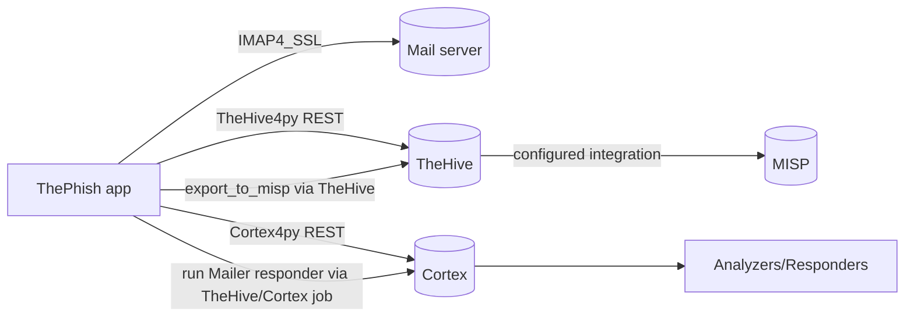

# ThePhish Integration Map (Reverse-Engineered)

Based on `app/list_emails.py`, `app/case_from_email.py`, `app/run_analysis.py`, `app/thephish_app.py`, configs, and Docker setup.

## 1. Integration overview

| Integration | Library/protocol | Config source | Primary callers | Purpose |
|---|---|---|---|---|
| IMAP mailbox | `imaplib.IMAP4_SSL` | `configuration.json.imap.{host,port,user,password,folder}` | `list_emails.py`, `case_from_email.py` | List unread EML submissions; fetch selected raw email |
| TheHive | `thehive4py.api.TheHiveApi` (+ models/query/helper) | `configuration.json.thehive.{url,apikey}`, `case.{tlp,pap,tags}`, `misp.id` | `case_from_email.py`, `run_analysis.py` | Case/template/task/observable CRUD, analyzer run trigger, responder run trigger, case update/close, MISP export |
| Cortex | `cortex4py.api.Api` | `configuration.json.cortex.{url,apikey,id}` | `run_analysis.py` | Discover analyzers by type, poll jobs, fetch reports/job status |
| MISP | indirect (TheHive export; Cortex `MISP_2_1` analyzer in ecosystem) | `configuration.json.misp.id`, TheHive/Cortex/MISP app configs | `run_analysis.py` verdict finalization; analyzers | IOC/case export on malicious verdict; threat intel lookups via analyzer |
| Mailer responder | responder `Mailer_1_0` executed through TheHive/Cortex job APIs | responder config in Cortex (SMTP settings) | `run_analysis.py.notify_start_of_analysis`, `terminate_analysis` | Notify submitter of analysis start and final verdict |
| Web UI realtime | Flask-SocketIO / Socket.IO events | runtime `sid` | `thephish_app.py`, `ws_logger.py`, `thephish.js` | Progress/log streaming to analyst browser |

## 2. IMAP integration

### Connection and auth
- **Client:** `imaplib.IMAP4_SSL(config['imapHost'], config['imapPort'])` then `connection.login(config['imapUser'], config['imapPassword'])`.
- **Mailbox:** `connection.select(config['imapFolder'])` (default example `inbox`).

### Operations
- **List flow (`list_emails.py:retrieve_emails`)**
  - `search(None, '(UNSEEN)')`
  - `fetch(uid, '(RFC822)')` per unseen message
  - MIME walk to detect attached/internal EML and preview fields
- **Case flow (`case_from_email.py:obtain_eml`)**
  - `select`, `search(None,'(UNSEEN)')` and verify selected UID still present
  - `fetch(mail_uid, '(RFC822)')` to obtain full message and extract internal EML
- **State/flags:** code logs "flagged as read" after fetch in case flow; no explicit `STORE` flag management shown.

### Lifecycle/error handling
- Connections created per operation path; no explicit logout/close shown in inspected code.
- Exceptions logged and surfaced to UI via `wsl.emit_error` in case flow; listing prints/logs and may return `None` on failure.

## 3. TheHive integration

### API client initialization
- `api_thehive = thehive4py.api.TheHiveApi(config['thehiveURL'], config['thehiveApiKey'])` in case and analysis modules.

### Case/template/task/observable operations
- **Template discovery/create (`case_from_email.create_case`)**
  - `find_case_templates(query=Eq("name","ThePhish"))`
  - `create_case_template(CaseTemplate(name='ThePhish', titlePrefix='[ThePhish] ', tasks=[notification,analysis,result]))`
- **Case creation:** `create_case(Case(..., template='ThePhish'))`
- **Observable creation:** `create_case_observable(case_id, CaseObservable(...))` for header/body/file/hash/eml and unshortened URL.
- **Observable reads/updates:** `get_case_observables`, `get_case_observable`, `update_case_observables(..., fields=['ioc'])`.
- **Task operations:** `get_case_tasks`, `update_case_task` to set `status` and `description`.
- **Case resolution:** `CaseHelper(api_thehive).update(..., status='Resolved', resolutionStatus, impactStatus, summary='Automated analysis')`.

### Analyzer and responder invocation via TheHive API
- **Run analyzer:** `api_thehive.run_analyzer(config['cortexID'], observable_id, analyzer.name)` (returns Cortex job id in `cortexJobId`).
- **Run responder:** `api_thehive.run_responder(responder.id, 'case_task', task_id)` for `Mailer_1_0`.

### MISP export via TheHive
- `api_thehive.export_to_misp(config['mispID'], case_id)` when verdict is `Malicious`.

## 4. Cortex integration

### API client initialization
- `api_cortex = cortex4py.api.Api(config['cortexURL'], config['cortexApiKey'])` in `run_analysis.py`.

### Analyzer discovery and compatibility
- `api_cortex.analyzers.get_by_type(type)` for `file,url,domain,ip,mail,hash`.
- Dispatch filtered by observable type and special-case rules:
  - `Yara_2_0` only for EML file (`file_message/rfc822`).
  - `UnshortenLink_1_2` first/special for URLs.
  - `DomainMailSPFDMARC_Analyzer_1_1` only for domain observables in selected header contexts.

### Job monitoring and report retrieval
- Poll `api_cortex.jobs.get_by_id(job_id)` every 5s until `Success` or `Failure`.
- Retrieve reports via `api_cortex.jobs.get_report(job_id)`; parse `report.summary.taxonomies` and selected `report.full` fields.
- **Rate limiting:** if analyzer start response includes `RateLimitExceeded`, job start retried later (10s loop).

### Responder job monitoring
- Mailer responder jobs (started through TheHive) polled via Cortex jobs API for completion status.

## 5. MISP integration

- **Direct ThePhish call:** only `export_to_misp` on malicious final verdict.
- **Ecosystem integration:** MISP is a configured external service (Docker stack, TheHive application config, Cortex `MISP_2_1` analyzer enablement in docs). MISP analyzer reports can influence verdict as generic analyzer outputs when enabled/configured.
- **Conditions:** export attempted only when computed verdict == `Malicious`; success/failure logged as info/warning.

## 6. Notification integration (Mailer responder)

- **Responder identity:** `Mailer_1_0` looked up by `api_cortex.responders.get_by_name`.
- **Start notification:** task description set to `mailto:<external sender>\nThe analysis of the email ... has just started...` then responder executed on Notification task.
- **Verdict notification (final only):** Result task description set to `mailto:<mail_to>\nThanks for your submission... classified as <verdict>` for Safe/Malicious; responder executed before closing.
- **Suspicious case:** placeholder description inserted for analyst action; no automatic verdict mail sent by this path.
- **Transport/config:** SMTP credentials/settings are external to app code (configured in Cortex responder settings).

## 7. Web UI / realtime integration

- **HTTP:** browser calls `/list` and `/analysis`.
- **WebSocket (Socket.IO):** server emits `logInfo`, `logWarning`, `logError` to client `sid`; client appends messages to log panel and updates progress/result UI.
- **Coupling:** analysis request requires client-provided `sid` for progress; no durable event stream.

## 8. Configuration and credential flow

| File | Fields used | Consumers |
|---|---|---|
| `configuration.json` | `imap.*`, `thehive.*`, `cortex.*`, `misp.id`, `case.*` | list/case/run modules |
| `whitelist.json` | exact/regex/domain-in-* lists | case extraction and URL-unshorten acceptance |
| `analyzers_level_conf.json` | analyzer `dataType`, `levelMapping` | run report normalization |
| `logging_conf.json` | handlers/formatters/loggers | all modules via `logging.config.dictConfig` |

- Secrets/API keys are read as plaintext JSON values; no secret manager abstraction in app code.

## 9. Provider-independent adaptation notes for PhishGuard

- **Keep local-first core independent:** PhishGuard should treat IMAP/TheHive/Cortex/MISP/mailer as optional adapters behind interfaces, not hard runtime dependencies.
- **Normalize external contracts:** define internal models for observable, analyzer job, report, severity, case/task, and notification events; map ThePhish/TheHive/Cortex/MISP specifics in adapter layers.
- **Preserve explainability:** store raw provider verdict/taxonomy and normalized verdict separately (ThePhish maps away original levels).
- **Make orchestration resilient:** replace unbounded sleep/poll loops with timeout/cancellation/retry policies and idempotent job tracking.
- **Secure configuration:** isolate credentials, support env/secret stores, avoid logging secrets/PII, and validate integration endpoints/TLS settings. 
