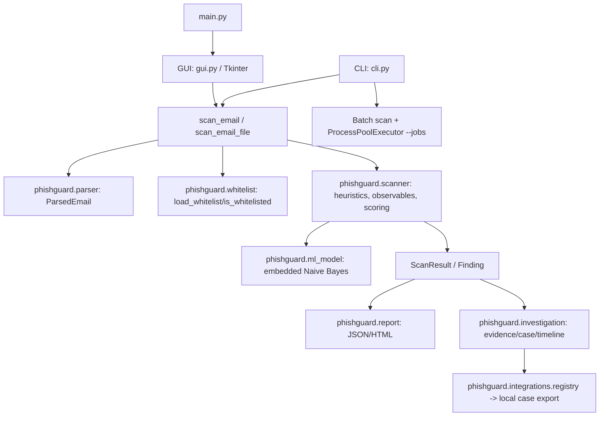

# PhishGuard Architecture

## 1. Purpose and design principles

PhishGuard is a local, explainable phishing triage tool for analyzing raw email source (including Gmail “Show original”), `.eml` files, and pasted text. It prioritizes:

- **Local/offline-first operation** by default (no mandatory external services).
- **Safety:** no attachment execution, no automatic browsing of suspicious URLs, no default third-party uploads.
- **Explainability:** heuristic findings, risk scoring, recommendations, and ML as an additional signal.
- **Compatibility:** stable CLI/GUI workflows and Python API (`scan_email`, `scan_email_file`).

## 2. Current implementation (codebase)



| Component | Responsibility | Key files |
|---|---|---|
| Entry points | Launch GUI/CLI and expose package API | `main.py`, `gui.py`, `cli.py`, `phishguard/__init__.py` |
| Parsing | Raw/RFC822/simple-header parsing, MIME body/attachment extraction, auth-header capture, size guard | `phishguard/parser.py` |
| Detection/scoring | Observable extraction, whitelist-aware checks, header/URL/content/attachment/identity heuristics, 0–100 verdict, recommendations | `phishguard/scanner.py` |
| ML signal | Embedded, explainable phishing/legitimate likelihood and indicators (stdlib), toggleable per scan | `phishguard/ml_model.py` |
| Whitelisting | PhishGuard and ThePhish-compatible schema loading, matching, validation, and exact-rule editing | `phishguard/whitelist.py` |
| Investigation | Evidence hashing/provenance, normalized analyzer result, observable dedup, case/timeline, analyst actions | `phishguard/investigation.py` |
| Integrations | Provider contracts, registry, local case JSON export, safe null providers | `phishguard/integrations/` |
| Reporting/export | Human-readable/JSON/HTML single and batch report generation | `phishguard/report.py` |
| Tests/samples | Regression, CLI, investigation, whitelist, and report coverage | `tests/`, `samples/*` |

## 3. Data flow (local scan)

1. **Input:** pasted raw source, `.eml`/text file, or batch path list.
2. **Parse:** `parse_email_text/file` produces `ParsedEmail` (headers, body, received/auth, attachments, raw).
3. **Analyze:** `scanner.scan_parsed` normalizes/extracts observables, applies whitelist and heuristic/ML analyzers, accumulates findings and score, and builds recommendations.
4. **Verdict/report:** produce `ScanResult` (verdict/rating/score, findings, reasons, observables, auth claims, ML/category data) and render/export via CLI/GUI/report helpers.
5. **Case:** `scan_result_to_investigation` adds SHA-256 evidence, a normalized analyzer result, and a timeline; analyst verdict/notes are appended as events and the case exports as local JSON through `DEFAULT_REGISTRY`.
6. **State:** in-memory results/history in UI/CLI context; case JSON is written only when the user exports it.

## 4. ThePhish-informed target architecture (incremental, independent)

Reverse-engineering analysis in `analysis/` identified useful concepts (observable normalization/provenance, analyzer orchestration, severity normalization, investigation case/evidence/timeline, optional SOC adapters). PhishGuard adopts these **as independent implementations** behind modular interfaces while keeping the local core functional without external services.

```text
phishguard/
  core/            # models, config, events, engine/orchestrator (additive)
  ingestion/       # file/paste loaders; optional IMAP adapter
  observables/     # extractor, normalizer, deduplicator, validator
  analyzers/       # local analyzers (headers/auth/url/content/attachment/ml)
  orchestration/   # registry, dispatcher, jobs, result collection
  detection/       # normalization, correlation, scoring, verdict
  cases/           # investigation, evidence, timeline, analyst decisions
  integrations/    # optional thehive/cortex/misp/generic adapters
  reporting/       # json/html/investigation reports
  gui/ cli/ tests/
```

> This structure is a target; implementation should be incremental and adapted to existing modules to avoid unnecessary rewrites.

## 5. Security and safety boundaries

- Treat all email content (headers, MIME parts, HTML, URLs, attachments) as untrusted input.
- SPF/DKIM/DMARC/ARC/Received-SPF values are parsed as **header claims, not independently verified** unless explicitly verified by a future optional component.
- Analyzer/provider failures or missing results must be represented as `unknown/error` evidence and must not be interpreted as “safe”.
- Credentials and integration secrets must never be hardcoded or logged; optional integrations are explicit opt-in.

## 6. Related documents

- `analysis/PHISHGUARD_GAP_ANALYSIS.md`, `analysis/PHISHGUARD_IMPLEMENTATION_ROADMAP.md`
- `docs/ORCHESTRATION.md`, `docs/DETECTION_METHODOLOGY.md`, `docs/INTEGRATIONS.md`, `docs/CONFIGURATION.md`, `docs/TESTING.md` 
