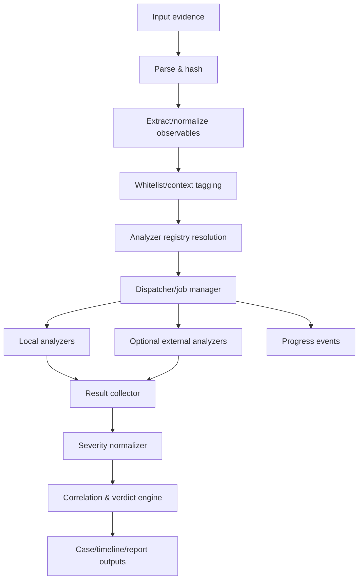

# Orchestration Design (Planned/Incremental)

This document defines the ThePhish-inspired, independently implemented orchestration model for PhishGuard. It complements the current in-process scan pipeline (`phishguard/scanner.py`) with modular analyzer execution, normalization, and explainable correlation.

> **Current state (implemented now):** the single-pass pipeline already produces evidence hashes, observables, normalized analyzer results, an `InvestigationCase` with timeline, and context-aware recommendations. A provider registry (`phishguard.integrations.registry`) with a local case-export provider is live, and batch scanning runs through bounded CLI workers (`--jobs`) or a background GUI thread. The dispatcher/job-manager concepts below remain the target for adding optional external analyzers.

## 1. Objectives

- Run multiple local analyzers consistently over parsed email evidence and extracted observables.
- Support bounded concurrency, timeouts, retries (where safe), cancellation, and progress events.
- Collect structured results with provenance and preserve original analyzer outputs.
- Normalize and correlate results into an explainable verdict without treating missing/error results as safe.
- Enable optional external providers/adapters without making them required for core scans.

## 2. Core concepts

| Concept | Description |
|---|---|
| **Evidence** | Immutable input artifacts: raw email text/EML bytes, hashes, parse metadata, timestamps |
| **Observable** | Extracted indicator (url/domain/ip/email/hash/file/header field/etc.) with normalized value and provenance |
| **Analyzer** | Unit that consumes evidence/observables and emits structured findings/results |
| **Job** | One analyzer execution instance with state, timing, retries, and diagnostics |
| **AnalyzerResult** | Raw analyzer output + status (`success/timeout/error/skipped`) + emitted findings/observables |
| **NormalizedFinding** | Finding mapped to common severity/confidence/category schema |
| **Verdict** | Correlated outcome with score/confidence, rationale, and unknowns |

## 3. Analyzer contract (target)

Each analyzer declares:

- `id`, `name`, `version`, `description`
- `supported_observable_types` / `input_kinds` (e.g. raw email, headers, URL, attachment metadata)
- `requirements` and configuration schema
- `timeout_ms`, `enabled` (default), `local_only` flag
- output schema: findings, observables discovered, raw result, status, errors

**Built-in local analyzers (mapping from current behavior):**
- Parser/evidence analyzer (structure, MIME, encoding, size/hash metadata)
- Authentication/header analyzer (SPF/DKIM/DMARC/ARC header claims, routing/identity anomalies)
- URL/domain analyzer (extraction, normalization/defang, schemes, punycode/lookalike)
- Content/body analyzer (phishing language, hidden content, forms/scripts indicators)
- Attachment analyzer (names/types/extensions, double extension, archives/macros indicators; no execution)
- ML analyzer (`phishguard.ml_model`, embedded stdlib NB)
- Whitelist/context analyzer (records whitelist matches and scope; does not auto-mark safe)

## 4. Execution model

### Dispatcher behavior
- Resolve applicable analyzers by enabled state, prerequisites, and observable compatibility.
- Execute independent jobs with bounded concurrency (thread/process/task pool as appropriate to analyzer type).
- Enforce per-job timeout and overall scan budget.
- Isolate failures: one analyzer error must not abort the entire scan unless evidence parsing fails.
- Record retries only for explicitly retry-safe operations (never duplicate side-effecting external actions).

### Job states
`queued -> running -> succeeded | failed | timed_out | canceled | skipped`

Each job records start/end timestamps, duration, attempt count, error details, and emitted result references.

## 5. Result collection and normalization

- **Collector:** validates result schema, deduplicates findings/observables, preserves analyzer identity and raw outputs.
- **Normalizer:** maps analyzer/native severities to `informational`, `safe`, `suspicious`, `malicious`, `unknown`, `error`.
- **Unknown/error handling:** missing reports, timeouts, malformed outputs, or provider failures become explicit `unknown/error` findings/evidence gaps; they reduce confidence and may require analyst review, but never count as benign proof.

## 6. Correlation and verdict

The verdict engine correlates:
- sender/domain/authentication context (header claims clearly labeled)
- header/routing anomalies and identity mismatches
- URL/domain reputation-like local signals and observable patterns
- content/lure indicators and ML output
- attachment risk indicators
- optional external intelligence/analyzer results

Output includes: final verdict/risk, confidence, key evidence, contributing findings by category, contradictions/whitelisted context, and gaps/unknowns. Automated verdicts must be distinguishable from analyst-confirmed verdicts in investigation workflows.

## 7. Progress and observability

- Emit structured events: `scan_started`, `evidence_parsed`, `observables_extracted`, `analyzer_queued/running/completed/failed`, `verdict_ready`, `report_generated`.
- CLI/GUI should render actual backend events/state; long operations must not present simulated progress.
- Events and results should support redaction of sensitive values when exported/shared.

## 8. Compatibility and rollout

- Phase 1: keep `scan_email`/`scan_email_file` behavior and report schema compatible; implement orchestration internally.
- Phase 2: add investigation/case/timeline APIs and enriched reports as additive outputs.
- Phase 3: register optional external adapters behind the same analyzer/job contracts and disabled-by-default configuration.

## 9. What is implemented today

| Capability | Where | Notes |
|---|---|---|
| Evidence hashing and provenance | `phishguard/investigation.py` | SHA-256 per evidence record, source label, timestamps; originals are never modified |
| Observable normalization/dedup | `phishguard/investigation.py` | URL/domain/IP/email values normalized (lowercase host, strip trailing dot) and merged with tags |
| Normalized analyzer result | `phishguard/investigation.py` | Records verdict, score, confidence, findings count, errors/unknowns |
| Investigation case + timeline | `phishguard/investigation.py` | `case_*` ID, status, analyst verdict/notes, timeline events; built by `scan_result_to_investigation` |
| Case export provider | `phishguard/integrations/local_export.py`, `registry.py` | `DEFAULT_REGISTRY.export_case(case_dict, path)`; null provider remains the safe fallback |
| Recommendations | `phishguard/scanner.py` | Generated once, stored on `ScanResult.recommendations`, reused across outputs |
| Batch execution | `cli.py` (`--jobs`), `gui.py` (background thread) | Bounded workers, progress, cancellation, per-file cases |

Not yet implemented: the full dispatcher/job-manager, per-analyzer timeouts, retry policy, structured progress event stream, and any external analyzer/provider. Those remain the target contract in sections 3–8. 
